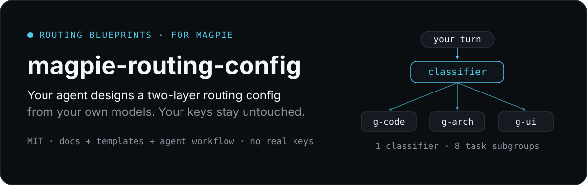
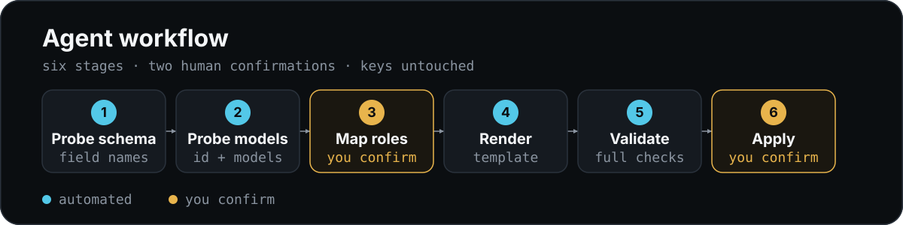
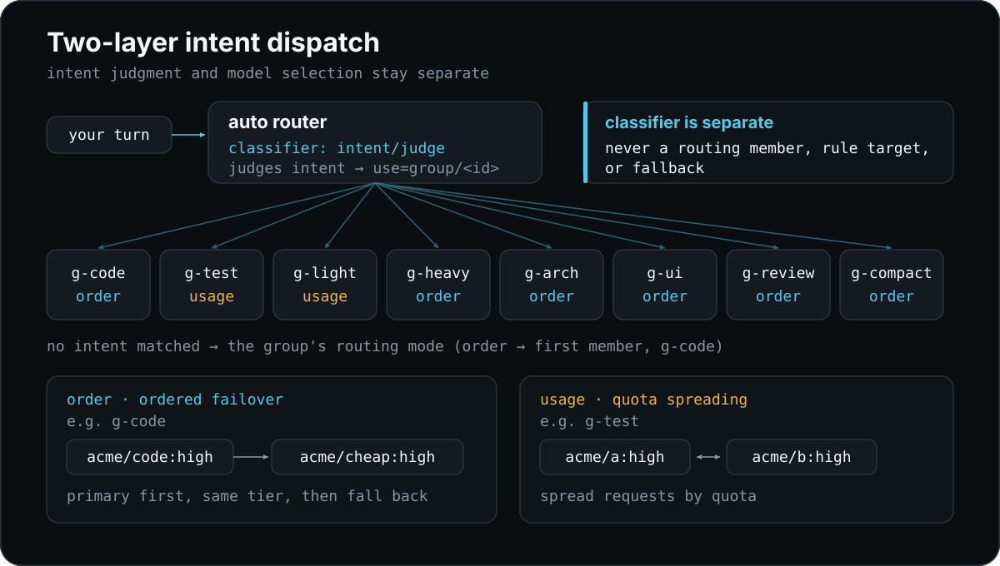

# magpie-routing-config

**English** | [中文](README.zh.md)



**Open-source routing-strategy blueprints for [magpie](https://usemagpie.ai)** — distills "how to design magpie routing" into docs + templates + an agent workflow. Contains no real keys or machine-specific config.

> Independent community project; not affiliated with or endorsed by the official [magpie](https://github.com/yetone/magpie) team.

## Who it's for

People who already run [magpie](https://usemagpie.ai) (a macOS menu-bar AI routing gateway; [GitHub](https://github.com/yetone/magpie)) with model providers configured, and want better routing. You don't need to study the config format — hand this repo to your agent.

## Prerequisites

- **macOS with [magpie](https://usemagpie.ai) installed and your providers configured** — this repo edits the routing layer of a magpie you already run; it neither installs nor replaces magpie. The acceptance suite below needs neither magpie nor your providers.
- **Python 3.7+** — standard library only, nothing to `pip install`. The scripts run on macOS's own `/usr/bin/python3` (3.9). The acceptance suite below needs **Python 3.12+** (one of its fixtures encodes a 1000-level nested JSON value; older CPython raises `RecursionError` inside `json` — the suite checks this up front and says so in plain words).
- **bash** and **git** — to run the acceptance suite and the commit gate.
- **magpie v0.1.4130** is the version the field reference was verified against ([docs/schema.md](docs/schema.md)); the routing-observation notes in [docs/patterns.md](docs/patterns.md) and [docs/concepts.md](docs/concepts.md) were measured on v0.1.4178. Other versions are expected to work but are not verified; the workflow probes *your* config first anyway.

## 30-second quickstart

```bash
git clone https://github.com/evenchan86/magpie-routing-config.git && cd magpie-routing-config
```

Then tell your agent (Claude Code / Codex / …):

> Read this repo's AGENTS.md and configure my local magpie routing following the workflow.

The agent will: probe your local config schema → discover your providers and models → propose a role→ordered-model-list mapping (**you confirm**) → render a two-layer routing draft → validate → back up and merge-write (**you confirm**).



Your providers and keys **stay untouched**; this repo only touches the routing layer (groups/rules/classifier).

## Core concept: two-layer intent dispatch

Routing is split into two layers so intent judgment and model selection stay separate:



- **Main router (`auto`)** — a small fast **classifier** judges the intent of each turn, then dispatches to a task subgroup via `use=group/<id>`. It does no model selection itself. When no intent matches, it falls back **by the group's routing mode**; the template uses `order`, so that means its first member (the everyday-coding subgroup).
- **Task subgroups** — eight groups (`g-compact` / `g-test` / `g-light` / `g-code` / `g-heavy` / `g-arch` / `g-ui` / `g-review`), each owning **multiple model members** and a routing mode (`order` for ordered failover, `usage` for quota spreading). Per-model reasoning effort is set with the `:effort` member suffix. A role maps to an ordered model list, so each subgroup can hold several models (e.g. a primary coder → a backup coder → a cheap fallback at the same effort; the main-chain groups share one anchor model — see `docs/patterns.md` pattern 13).

The classifier is a **separate role**: it only judges intent and is **never** a routing member, rule target, or fallback.

## Model roles

Strategies aren't bound to specific models. Six capability roles are mapped to **ordered lists of your own models** (primary first; multiple models give failover or quota pools). `scripts/render.py` expands each template member `<role:X>:effort` into every model in that role's list. Effort defaults to the slot's, and a model can override it by writing `model@effort` in the mapping (combine as `provider/model#account@effort`) — so one subgroup can mix efforts (mapping `acme/vision@high` under a `:medium` slot renders `acme/vision:high` beside `acme/code:medium`):

| Role | Purpose |
|---|---|
| `intent/judge` | Intent classification **only** (the classifier); never a routing member/target/fallback |
| `reasoning/strong` | Architecture, hard debugging, large changes |
| `code/general` | Implementation, bug fixes, tests, review |
| `design/ui` | UI, styling, visual reproduction (incl. screenshots) |
| `fast/cheap` | Simple Q&A, lightweight fallback (not the classifier) |
| `context/long` | Long-context summarization |

**How models get picked for a role:** `templates/roles.json` carries machine-applicable `signals` per role — the model name is lowercased and split into segments, and a token counts only on a **whole-segment** match (substring matching would misread model names that happen to contain `mini` or `max`). Within a role a negative signal vetoes a positive one; a model matching several roles is left for you to decide; a model matching **no** signal is still listed for your confirmation rather than dropped. Capability data is not guessed from names: context windows come from the provider's `contexts` field **for the models it covers** (it may list only some of them, or use `*`); anything it doesn't cover, plus multimodal support and reasoning tiers, must be confirmed with you.

Seven mutually exclusive intents (test / Q&A / implement / refactor / architecture / UI / review) + a reasoning trigger + a compaction rule cover the coding loop. See the [routing pattern library](docs/patterns.md).

## Repository layout

```text
AGENTS.md                  # agent workflow & red lines (entry point)
CONTRIBUTING.md            # how to contribute, how to run the suite, how to enable the commit gate
CHANGELOG.md               # user-visible change record (the version is the git commit)
docs/
  concepts.md              # routing concepts (two layers, pools vs failover)
  schema.md                # config field reference (with source & confidence notes)
  patterns.md              # routing pattern library
templates/
  roles.json               # role definitions, matching signals & mapping
  groups.template.json     # two-layer routing template (role placeholders)
examples/demo/             # end-to-end example with a fictional provider
.githooks/                # the repo's own git hook (enable with core.hooksPath)
scripts/
  render.py                # expand role->model-list mapping into the template (multi-model subgroups)
  validate.py              # routing-layer draft validator (group refs, classifier separation)
  apply.py                 # upsert-merge a draft into local config (dry-run by default, shows field changes for replaced groups, never echoes credentials; --write backs up, verifies on disk, auto-restores on failure)
  docgate.py               # shared judgment library of the two gates: public-surface extraction, exemption parsing, CLI contract parsing
  commit-gate.py           # the pre-commit gate contributors and the git hook run (docs sync; --docs-only skips the review archive)
  doctor.py                # read-only diagnosis of existing config (+ schema-legal but cost-/resilience-relevant shape advisories, + wiring smoke-test steps incl. CLI writes)
  e2e.sh                   # isolated acceptance test
```

## Example

[examples/demo/](examples/demo/README.md) walks from local config to a two-layer routing artifact using a fictional provider `acme/*`.

## Acceptance test

The repo ships its own isolated acceptance suite — fake `HOME`, temporary config, no writes to your real magpie setup:

```bash
bash scripts/e2e.sh
```

The last line should read `E2E PASS: 143 checks` (the count grows with the suite; trust the actual output), exit code 0.

## Support

Questions, corrections, and "this doesn't match my magpie" reports go to [GitHub issues](https://github.com/evenchan86/magpie-routing-config/issues) — please include your magpie version, your Python version, the exact command, and the output with anything secret-looking already masked (keep the shape, don't paste the real value).

To change the repo itself: [CONTRIBUTING.md](CONTRIBUTING.md) — how to run the suite, how to enable the commit gate, what a PR is expected to contain. What changed for users over time: [CHANGELOG.md](CHANGELOG.md).

## Honesty note

The schema docs are grounded in the [official docs](https://usemagpie.ai/docs/zh), the magpie CLI help, and empirical probes — but are **not a substitute for your own machine**: the agent workflow defers to probing your actual local config. Fields with uncertain semantics are flagged individually in [schema.md](docs/schema.md).

## License

[MIT](LICENSE)
